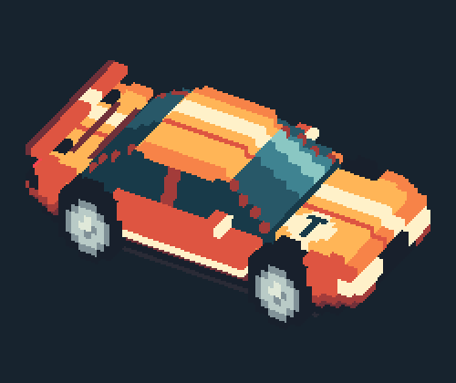
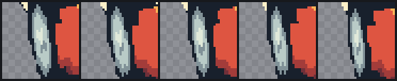
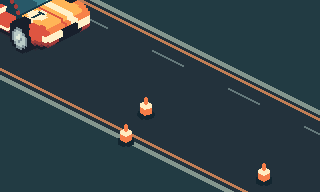

# Copper Rally



Fifteen horizontal slices describe the body and tires. Four placements of one 7 × 7 `hub` decal put the alloy rims on the outer tire faces. The 4× projection makes a 250 × 210 frame at each heading. The GIF shows those frames at 2× display size, with 70 ms per heading.

The [rim comparison](rim-comparison.gif) shows the earlier 2 px rim beside the painted sidewall at the same size and headings, from 0° through 30° and back.

Open the [editable car](../../examples/copper-rally.stack.json) in Studio to paint a sidewall or scrub the turn. Select **Drawing → hub** to edit all four wheels. To compare the painted face and the tire edge, select **Pin detail** and click the centre of the left wheel in the south side view (12, 10). At heading 90° the strip shows 88° through 92°. The model keeps the same ground pivot throughout.



The front wheel above is pinned at south (42, 10). The five cells follow it at one-degree intervals, including headings between animation frames.

```sh
node bin/pixelbolt.js preview examples/copper-rally.stack.json --open
node bin/pixelbolt.js inspect examples/copper-rally.stack.json --pin south,42,10,72 --scale 3 --out output/rally-wheel.png
node bin/pixelbolt.js gif examples/copper-rally.stack.json --scale 2 --background "#17232e" --out output/rally-turn.gif
```


The [pit lane scene](pit-lane.mjs) switches the car to `projection: "iso"`. The cones share one stack. Both cones along the near verge cover the car, including the cone beside the rear wheel. The car covers the two along the far verge. The depth view reports how many pixels overlap.

```sh
node showcase/copper-rally/pit-lane.mjs | node bin/pixelbolt.js scene - --scale 2 --image output/pit-lane.png
node showcase/copper-rally/pit-lane.mjs | node bin/pixelbolt.js scene - --view depth --image output/pit-lane-depth.png
```

### Ground-plane collision at 1×



At 0.96 s the front bumper sends the first cone across the lane. At 1.36 s the second starts sliding towards the verge. From 2.00 to 2.80 s the stationary cone overlaps the passing car.

`--cone-run` simulates a heavy bevelled car and three square cone bases on a flat floor. It projects the body tracks into scene trajectories and selects the nearest stack heading as each cone spins. The shot uses the order across the road to draw the near cones in front of the full length of the car. The GIF plays at the scene's native 320 × 192 pixels, 25 frames per second.

```sh
node showcase/copper-rally/pit-lane.mjs --cone-run | node bin/pixelbolt.js gif - --fps 25 --scale 1 --out output/cone-run.gif
```
