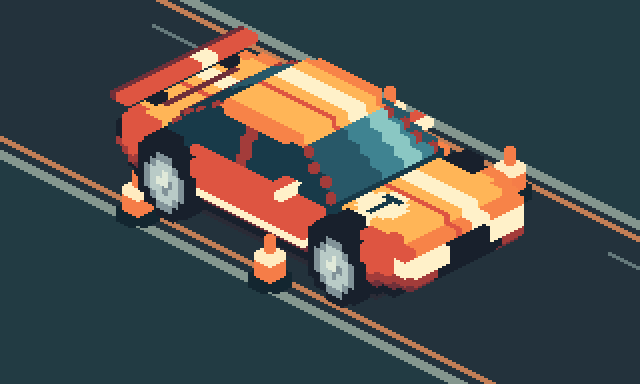

# Copper Rally


Fifteen horizontal slices describe the body and tires. Four 7 × 7 side paintings put the alloy rims on the outer tire faces. The 4× projection makes a 250 × 210 frame at each heading. The GIF shows those frames at 2× display size, with 70 ms per heading.

The [rim comparison](rim-comparison.gif) shows the earlier 2 px rim beside the painted sidewall at the same size and headings, from 0° through 30° and back.

Open the [editable car](../../examples/copper-rally.stack.json) in Studio to paint a sidewall or scrub the turn. To compare the painted face and the tire edge, scrub from 72° through 90°. The model keeps the same ground pivot throughout.

```sh
node bin/pixelbolt.js preview examples/copper-rally.stack.json --open
node bin/pixelbolt.js gif examples/copper-rally.stack.json --scale 2 --background "#17232e" --out output/rally-turn.gif
```



The [pit lane scene](pit-lane.mjs) switches the car to `projection: "iso"`. Each cone uses the same stack. The cone nearest the camera covers part of the car, and the car covers the cones on the far side. Run the second command to see the ground order and count the overlapping pixels.

```sh
node showcase/copper-rally/pit-lane.mjs | node bin/pixelbolt.js scene - --scale 2 --image output/pit-lane.png
node showcase/copper-rally/pit-lane.mjs | node bin/pixelbolt.js scene - --view depth --image output/pit-lane-depth.png
```
