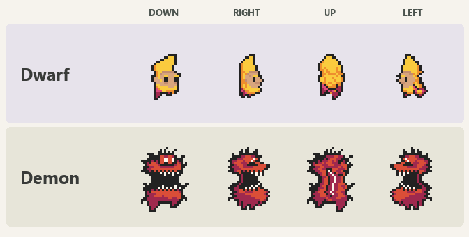

# Walks from two existing characters



The 16 × 28 dwarf and 32 × 36 demon start from transparent, unscaled PNGs. Each original is the first view in its editable sheet. I drew three additional views for the dwarf so her satchel hangs on the visible hip in one profile and disappears behind the coat in the other. I drew a back and one profile for the demon and enabled mirroring for its opposite side. Both keep the source palette. The review GIF synchronizes the characters for comparison. Their exported frames last 100 ms and 125 ms respectively.

| Original drawing | Standing views | Limb selections |
| --- | --- | --- |
| [Dwarf](sources/dwarf_f_idle_anim_f0.png) | [Dwarf view grids](dwarf.views.pixel.json) | [Dwarf cuts](dwarf.cuts.json) |
| [Demon](sources/big_demon_idle_anim_f0.png) | [Demon view grids](demon.views.pixel.json) | [Demon cuts](demon.cuts.json) |

## Reproduce a character

With the Pixelbolt CLI on your PATH, run these commands from this folder. Use an empty output folder. Replace `dwarf` with `demon` to build the second character.

```sh
pixelbolt render dwarf.views.pixel.json --out build/views/dwarf
pixelbolt import build/views/dwarf/dwarf-views.png --atlas build/views/dwarf/dwarf-views.atlas.json --name dwarf --cutout dwarf.cuts.json --out build/poses/dwarf.poses.json
pixelbolt inspect build/poses/dwarf.poses.json --motion walk-left --out build/dwarf-left.png
pixelbolt compile build/poses/dwarf.poses.json --out build/poses/dwarf.pixel.json
pixelbolt render build/poses/dwarf.pixel.json --out build/characters/dwarf
```

To start with your own single PNG, call `pixelbolt import your.png --out source.pixel.json` and `pixelbolt inspect source.pixel.json --grid`. Pick two feet in the grid and save their source rectangles under one facing in a cut manifest. Pass that PNG directly to the cutout import, omit `--atlas`, and leave out `frame` in its view. The guide includes a manifest you can use with the bundled profile. [Cutout guide](../../docs/agent-guide.md#cutout-walks-from-a-png)

For MCP, pass the rendered sheet path and the JSON contents of the atlas and cuts to `pixel_import`. Render its `revision` with `pixel_render`. To see the same review strip and foot measurements, pass its `sourceRevision` as `revision` to `pixel_inspect` with `view: "motion"` and `animation: "walk-left"`. The saved `sourceFile` holds the editable grids, joint overlaps, offsets and timings. Use `compile --expand` to retouch an individual step.

## Check in Godot

Copy the four files from [godot](godot/) into `build` after rendering both characters. Open `build/project.godot`. Arrow keys move and stop the actor. Keys 1 and 2 switch characters. The scene reads pixel pivots from the atlas and places an uncentered sprite at the ground position with the negative pivot as its offset. For a headless check run `godot --headless --editor --path build --import` then `godot --headless --path build --script res://verify.gd`. It exercises both actors, all four directions, the eight displayed frames, timing, stopping and the anchor after each transition.

## What still takes judgment

An agent or artist identifies the moving parts, draws hidden surfaces, chooses which profiles can be mirrored and checks that the costume still reads at native size. On the first pass, the dwarf's boots and the demon's jaw-shaped body's feet separated on individual frames. Keeping one or two opaque rows of each boot beneath the limb restored contact without changing either supplied standing drawing. A connected silhouette alone cannot certify the chosen anatomy or costume.

For a future external trial, record a public integration or voluntary report with the project, input asset, command or MCP call, the result in-engine and any manual repairs. Count repeat use when that same independent project imports a second distinct character. Keep first-time use and repeat projects as separate counts. These two reproductions were made during development.

## Credit

Original PNGs from *16x16 DungeonTileset II* by 0x72, CC0 1.0. The additional views and scripts are covered by the repository's MIT license. [Artist and license](https://0x72.itch.io/dungeontileset-ii) · [Pinned distribution copies](https://github.com/series-ai/jam-ready-assets/tree/520a0c794dd75723a14bcc668b8705a76d8e6a32/0x72-dungeon-tileset-ii/2D/dungeon/frames)
