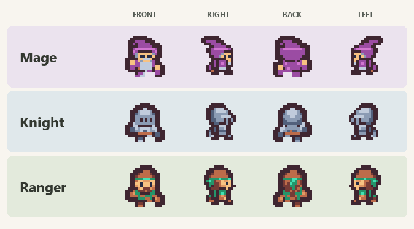

# Four-direction character walks



Each character starts from a single 16 × 16 sprite by Kenney. The standing front matches that PNG pixel for pixel inside a 24 × 24 transparent cell. The profile and back are newly drawn. The mage's beard and the knight's visor appear at the front, and the ranger's headband ties at the back. All three use the same cutout walk template. The preview synchronizes the steps for comparison. In game, the mage takes 120 ms a frame, the knight 110 ms and the ranger 90 ms.

| Character | Original | Editable poses |
| --- | --- | --- |
| Mage | [PNG](sources/mage.png) | [Pose source](mage.poses.json) |
| Knight | [PNG](sources/knight.png) | [Pose source](knight.poses.json) |
| Ranger | [PNG](sources/ranger.png) | [Pose source](ranger.poses.json) |

The back-view boots have two rows of shaft tucked behind the outfit. When the torso rises on steps 4 and 8, the extended boot still meets the hem along four pixels. The profile heels taper where they pass behind the sleeve. Across all 96 walk frames, each visible boot forms one edge-connected shape. With the sleeve and other boot hidden, each exposed boot meets the outfit along at least two pixels.

## Build the assets

From a Pixelbolt checkout containing `walkCycles`, run these commands. Substitute `knight` or `ranger` for `mage` to build the other characters. Use an empty output folder.

```sh
node bin/pixelbolt.js compile showcase/four-way-walk/mage.poses.json --out output/mage.pixel.json
node bin/pixelbolt.js render output/mage.pixel.json --out output/mage
```

Run `node --test test/four-way-boot-contact.test.js` to check the boot joins and all twelve standing drawings.

An agent using MCP can pass the pose JSON as `source` to `pixel_compile`, then pass the returned revision to `pixel_render`. To adjust an individual step, run `compile --expand`, edit the named pose, and compile that file.

Copy the exported `mage.png` and `mage.tres` together into a Godot 4 project. Assign the SpriteFrames resource to an AnimatedSprite2D, use nearest texture filtering, and play `walk-down`, `walk-right`, `walk-up` or `walk-left`. Single-frame `stand-*` animations are provided for stopping in each direction. The PNG and atlas JSON also work independently of Godot. [Walk authoring guide](../../docs/animate-your-sprite.md#four-direction-walks-from-drawn-parts)

## Art credit

Original front drawings from Kenney's **Tiny Dungeon 1.0**, CC0 1.0. The three files in `sources/` are unscaled crops of tiles 84, 96 and 112 respectively (tiles numbered from zero, across twelve columns). Pixelbolt's new views and pose recipes are MIT licensed. [Kenney's asset page](https://kenney.nl/assets/tiny-dungeon) · [Source sheet used](https://github.com/TheBestNinja/math-dungeon-crawler/blob/207fcea14c5ed73bd08241770939dad21a6cb6a7/public/assets/tilemap_packed.png) · [Original license](sources/Kenney-license.txt)
