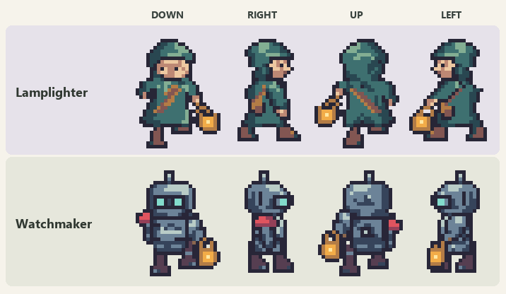

# Lamplighter and Watchmaker



[Lamplighter source](lamplighter.poses.json) · [Watchmaker source](watchmaker.poses.json)

Each source contains four standing drawings and eight steps per facing. The shoulder sockets and wrist joins are painted under the moving arms. The lantern handles retain their open centers. Both characters were drawn for Pixelbolt and are distributed under the repository's MIT license.

```sh
pixelbolt compile lamplighter.poses.json --out lamplighter.pixel.json
pixelbolt render lamplighter.pixel.json --out game --columns 8
```
