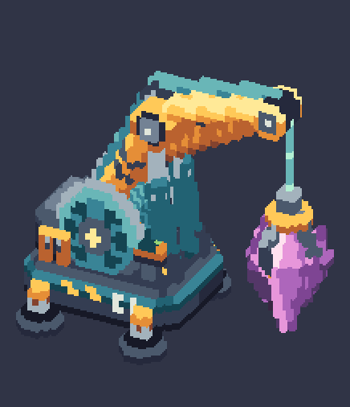

# Lodekeeper

[Faceted edition with a transparent crystal and a working turntable](faceted/README.md)



A yellow salvage crane winds a teal tether onto its drum and lifts a cluster of violet ore. The eastern mines and tether in [Tetherbore](https://github.com/skulitom/Tetherbore) inspired the design. The crane, grab and crystal were drawn for this asset.


The [transparent sprite sheet](lodekeeper.png) and [atlas JSON](lodekeeper.atlas.json) contain two loops. Each frame is 218 × 253 pixels with its ground anchor at (109, 200).

| Animation | Playback |
| --- | --- |
| `turn` | 40 headings, 9° apart, for a 3.60 s revolution |
| `hoist` | 16 playback frames, facing 342°. The load rises 32 pixels, pauses, and lowers during a 2.04 s cycle. |

The [editable stack](lodekeeper.stack.json) contains the slices, palette and side decals. Open it from the repository root with `node bin/pixelbolt.js preview showcase/lodekeeper/lodekeeper.stack.json --open`.

To rebuild both animations into a fresh output directory, run these commands from the repository root. The animation script reads the stack and trims all poses together so switching animations keeps the feet planted.

```sh
node showcase/lodekeeper/animate.mjs showcase/lodekeeper/lodekeeper.stack.json output/lodekeeper-rebuild.pixel.json
node bin/pixelbolt.js render output/lodekeeper-rebuild.pixel.json --scale 1 --columns 7 --out output/lodekeeper-rebuild
```

The [model builder](build.mjs) also recreates the original stack from its parts. Pass it a new `.stack.json` filename to keep an edited stack alongside it.
