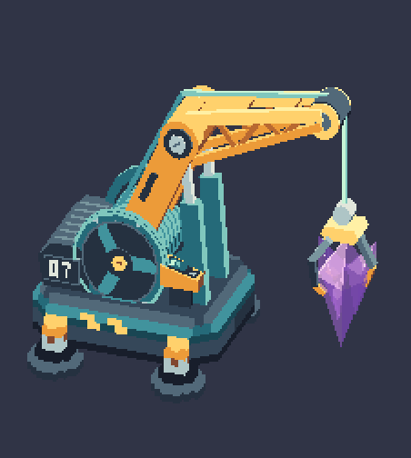

# Lodekeeper · faceted edition



A 72-heading isometric turn with a working hoist. The violet crystal has an inclusion, translucent faces, bright ridges and solid steel jaws. The orange boom has an open truss, machined bearings and a working three-spoke reel. Its number plate and controls stay attached as the machine turns.

**Use the [transparent animated PNG](turn.png) on your own background.** The GIF above shows the same pixels composited onto slate at 2×. Each frame on the [native sprite sheet](lodekeeper-faceted.png) measures 226 × 252 pixels. The [atlas JSON](lodekeeper-faceted.atlas.json) records a shared ground anchor at (113, 194) and the four attachment positions for each heading. The loop lasts 4.32 seconds, with a heading every 5°.

Open **Lodekeeper** in Studio or edit the [stack source](../../../examples/lodekeeper-faceted.stack.json). **Show attachment → grab** follows the shackle. The reel turns about its axle, and each end of the cable follows its own socket. The ground pedestal uses paintable slices. The truss, crystal and small markings use model-space faces.

To export into a new directory from the repository root, run:

```sh
node bin/pixelbolt.js render examples/lodekeeper-faceted.stack.json --columns 9 --out output/lodekeeper-faceted
```

The animation with alpha is written to `animations/turn.png`. The [model builder](build.mjs) recreates the editable stack when passed a new filename.
