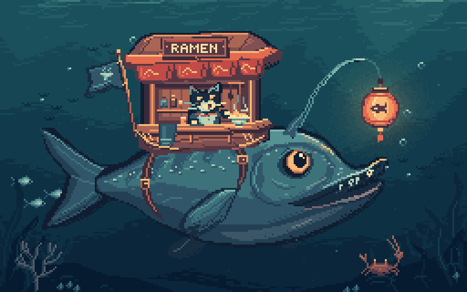

# Midnight Ramen

A cat serves noodles from an anglerfish's back. Its lure doubles as a paper lantern. The crab brought chopsticks.



The [256 × 160 recipe](midnight-ramen.json) plays 48 frames in 4.8 seconds. From the repository root, render it and inspect the palette with the CLI.

```sh
node bin/pixelbolt.js render showcase/midnight-ramen/midnight-ramen.json --out output/ramen-render --gif-scale 3
node bin/pixelbolt.js inspect showcase/midnight-ramen/midnight-ramen.json --diagnostics --frames swim-01 --out output/ramen-review.png
```

The fish, fins and roof use editable `polygon` vertices. To deepen the belly on the second frame, set `frames[swim-02].layers[anglerfish].ops[0].points[28]` to `[150,139]`. Use `frames[*]` in the same path to apply that edit throughout the loop.

Each frame's `groups.swimmer` adds one offset to nine layers. For example, setting `frames[swim-01].groups.swimmer` to `[3,-4]` raises the fish and its stall together. The pennant, ladle and lantern keep their own motion. The water and the crab stay in place.

The translucent lantern glow mixes with the water as it swings. Across the loop the inspector identifies 27 distinct off-palette colours as `alpha-blend`, with a sample pixel for each colour in each frame.
