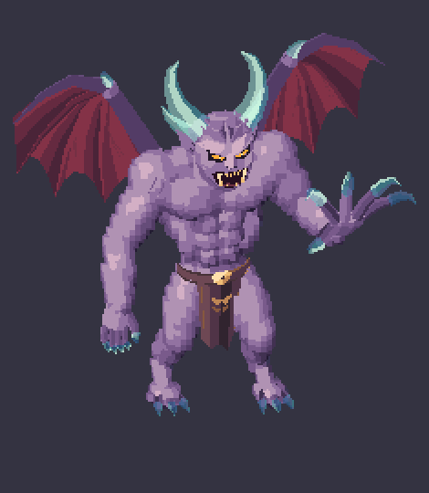
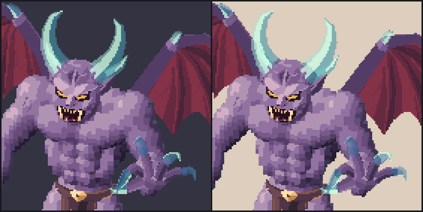
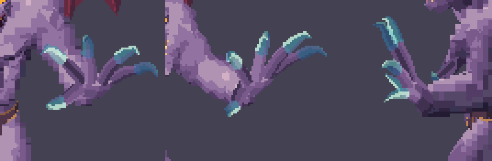

# Rimefiend



A 4.2-second turntable based on the demon reference. The reaching index curls and opens as the demon turns. The wing shoulders rotate and the individual ribs draw together on the rear view. The digitigrade legs and ridged back extend the design beyond the reference crop.



The horns, wing thumbs, fingernails and toenails are faceted blue-green crystal. Follow the long horn over the left wing in the two panels. The wing shows through its base, while the upper edge takes on the colour behind it. Both panels use the same pixels from the 333° heading.

The [animated PNG](turn.png) preserves partial alpha in every frame. The [sprite sheet](rimefiend.png) and [atlas](rimefiend.atlas.json) hold 60 frames of 235 × 270 pixels at 70 ms each. All headings share the ground anchor (117, 217). The GIF preview is enlarged 2× over slate.



From left to right the cameras face the palm (315°), take a three-quarter view (285°), and look along the fingers in profile (45°). The [labelled pose sheet](index-sheet.png) shows the open, half-curled and curled poses. The profile exposes the hooked silhouette, and the three-quarter view shows the nail crossing the other digits. The [transparent close-up](index-curl.png) keeps the crystal alpha. Each camera stays registered to the same knuckle.

In the stack, edit `paths.index` for the finger shape, `paths.index-nail` for the crystal, and `poses.curled.index` for the three bends. The nail bed sits at the tip origin. The [wing sheet](wing-sheet.png) shows the same two cameras with the ribs open and folded. The veins are painted onto the membrane between adjacent ribs.

The [editable stack](rimefiend.stack.json) renders directly in Pixelbolt. The [builder](build.mjs) defines the muscle volumes, individual finger and horn paths and the two wing sockets. To compare one wing at three angles while holding the camera and the body still, run

```sh
node bin/pixelbolt.js inspect showcase/rimefiend/rimefiend.stack.json --rotate wing-right,297,348,0,12 --scale 1 --out wing-study.png
```

To rebuild into a fresh directory from the repository root, run

```sh
node showcase/rimefiend/build.mjs output/rimefiend/rimefiend.stack.json
node bin/pixelbolt.js render output/rimefiend/rimefiend.stack.json --out output/rimefiend/export --columns 10 --scale 1
node bin/pixelbolt.js gif output/rimefiend/rimefiend.stack.json --out output/rimefiend/turn-preview.gif --scale 2 --background "#343341"
node showcase/rimefiend/crystals.mjs output/rimefiend/rimefiend.stack.json output/rimefiend/crystals.png
node bin/pixelbolt.js inspect output/rimefiend/rimefiend.stack.json --pose-sheet showcase/rimefiend/index-study.json --scale 3 --background "#434152" --out output/rimefiend/index-sheet.png
node showcase/rimefiend/curl.mjs output/rimefiend/rimefiend.stack.json output/rimefiend/index-curl
node bin/pixelbolt.js inspect output/rimefiend/rimefiend.stack.json --pose-sheet '{"poses":["open","folded"],"headings":[315,153]}' --scale 1 --background "#b6ad9f" --out output/rimefiend/wing-sheet.png
```
