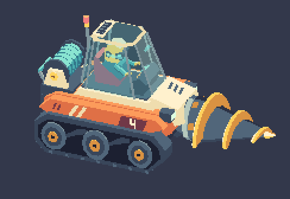
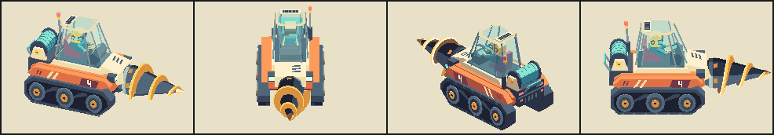

# Seamrunner No. 4



An original survey rover inspired by the flying drill and retrieval tether in [Tetherbore](https://github.com/skulitom/Tetherbore). The teal cable is wound onto a cassette behind the pilot. Up front, a gold cutting edge wraps around a dark tapered shaft. The spindle makes three revolutions during one turn of the rover.



The side view shows the helmet, earcup and hands through the glazing. Nose-on, the cutting edge overlaps into crescents and the console hides the pilot's hands. From the rear, the cable and seat take over the silhouette. The [fixed-camera spindle close-up](spindle.gif) shows one complete revolution with the twin lamps and hood held still.

The [animated PNG](turn.png) preserves partial transparency in the windows and roof. The [sprite sheet](seamrunner.png) and [atlas](seamrunner.atlas.json) contain 96 frames of 244 × 168 pixels at 50 ms each. Every frame shares the ground anchor (122, 125). The atlas also records the projected spindle centre for each heading.

Open the [editable stack](seamrunner.stack.json) in Pixelbolt Studio to scrub the turn. The spindle's final angle key sets the number of revolutions. The [builder](build.mjs) defines the track profiles, pilot, glass panes, tether cassette and spiral in model units.

To rebuild from the repository root into a fresh directory, run

```sh
node showcase/seamrunner/build.mjs output/seamrunner/seamrunner.stack.json
node bin/pixelbolt.js render output/seamrunner/seamrunner.stack.json --out output/seamrunner/export --columns 12 --scale 1
node bin/pixelbolt.js gif output/seamrunner/seamrunner.stack.json --out output/seamrunner/turn-preview.gif --scale 2 --background "#33384b"
node showcase/seamrunner/spindle.mjs output/seamrunner/seamrunner.stack.json output/seamrunner/spindle.gif
```
